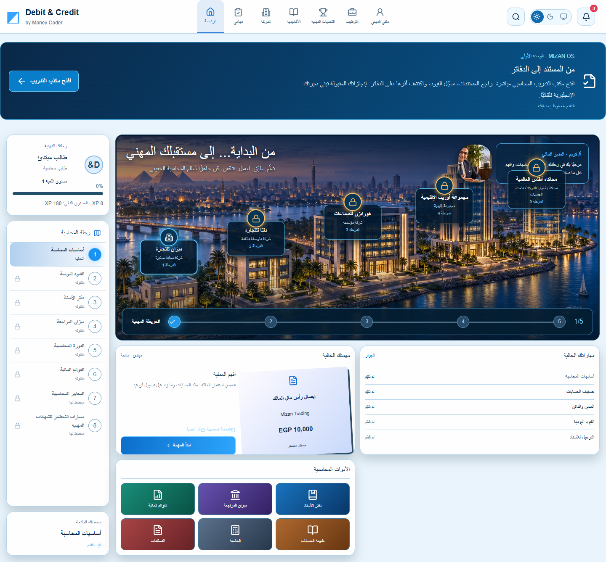
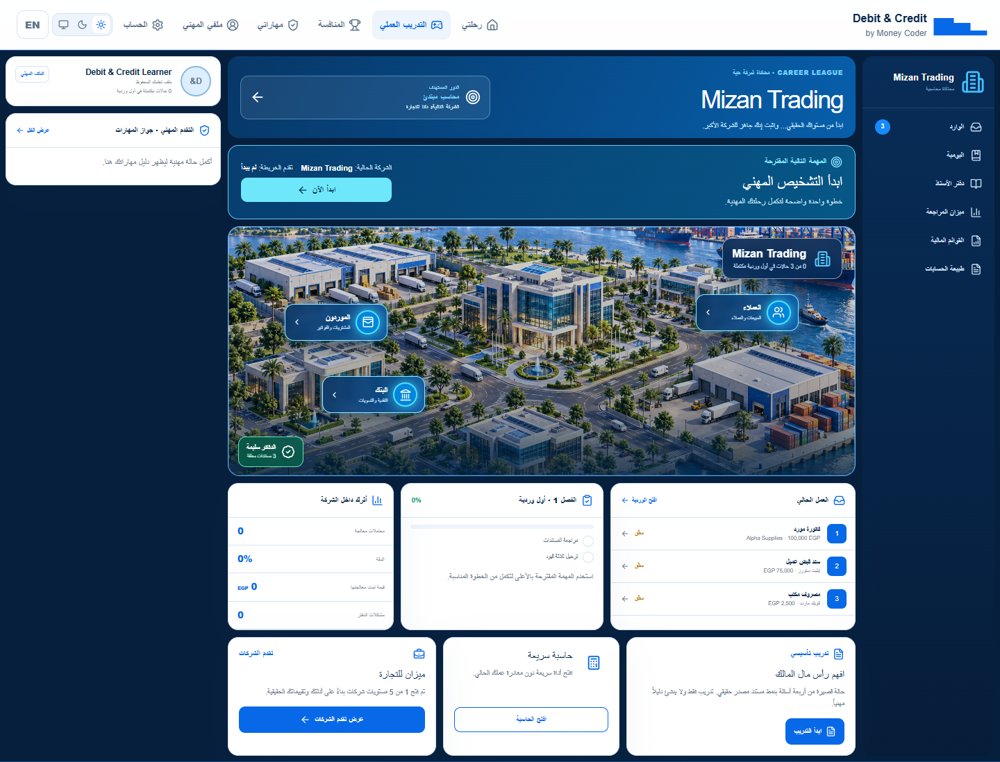
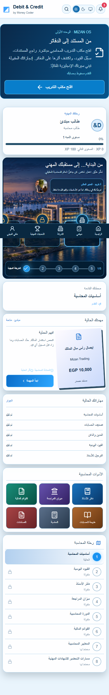
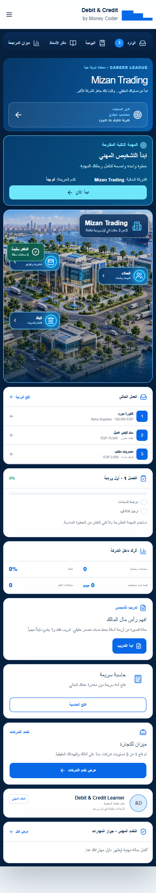
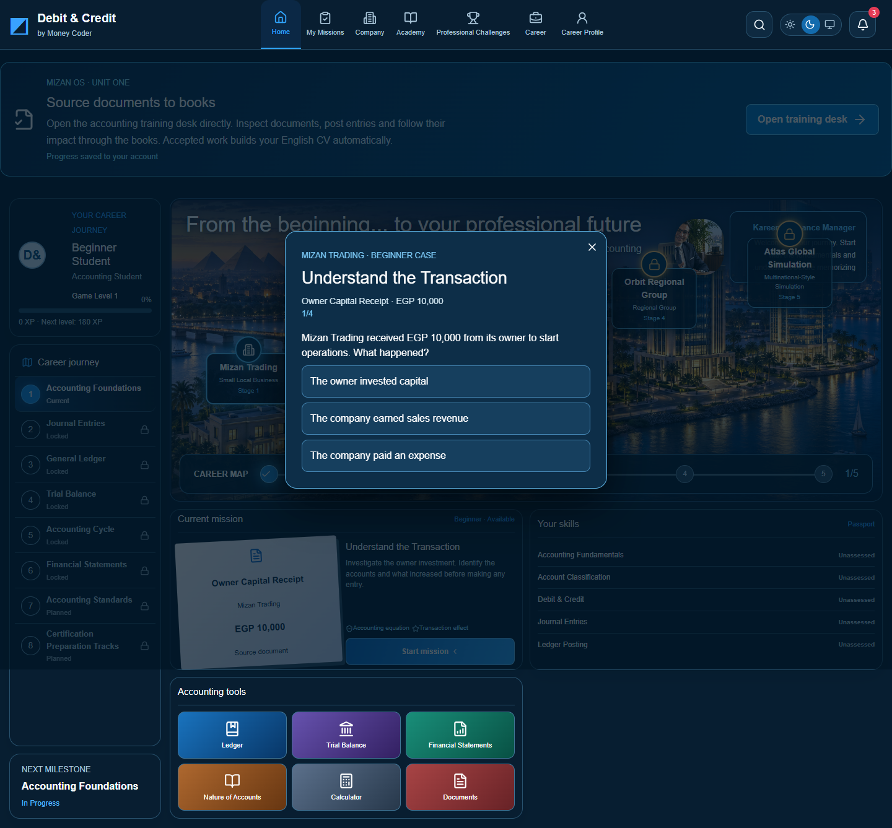
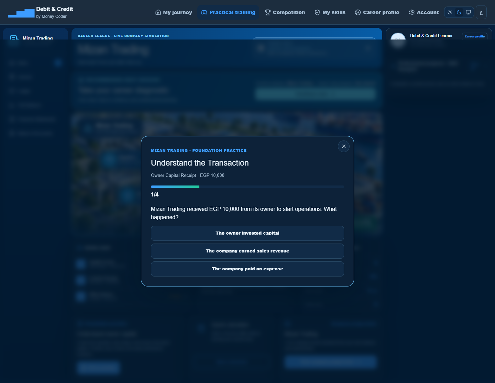

# تقرير Phase 3 الشامل — تنظيف ودمج تجربة الطالب بأمان

**المشروع:** Debit & Credit

**التاريخ:** 28 أكتوبر 2026

**الفرع:** `codex/phase3-remove-redundant-ux`

**القاعدة:** `codex/phase2-product-cleanup` / PR #50

**نقطة البداية:** `578879bfe732115bb789a0ba8d8b2a048cecf7c7`
**حالة التسليم:** Draft PR للمراجعة فقط — لا Merge ولا نشر Production.

## 1. الهدف

إزالة الواجهات المكررة وغير الضرورية داخل تجربة الطالب، ودمج الأدوات المفيدة في واجهة واحدة مترابطة مع الحساب والبيانات الحقيقية، من دون المساس بالمحتوى التعليمي الأساسي أو بيانات المستخدم أو مسارات المصادقة والـCV.

## 2. السبب الجذري

كان مسار الطالب يعرض أكثر من طبقة تنقل وتجربة بصرية لنفس الغرض:

- Game Hub أساسي، ثم عالم `BeginnerCareerWorld` ثانٍ بدا كأنه تطبيق منفصل.
- شريط تنقل عالمي ثم Rail يحتوي روابط عالمية مكررة.
- أكثر من CTA لبداية/استكمال نفس الرحلة.
- Roadmap أكاديمي ثانٍ يعرض مراحل مخططة أو مقفلة بجانب المحتوى العامل بالفعل.
- بطاقة مهنية كبيرة وتفاصيل readiness/rank/coins لا ترتبط كلها ببيانات مهنية حقيقية.
- رابط `StudentGameLink` كبير يكرر خطوة الرحلة المقترحة الموجودة بالفعل.

المشكلة لم تكن في قاعدة البيانات أو المصادقة؛ كانت في تجميع واجهات متراكمة من مراحل تطوير سابقة داخل نفس الشاشة.

## 3. ما تم قبل التعديل

تم إنشاء جرد قرار كامل في [PHASE3_DEDUP_INVENTORY.md](./PHASE3_DEDUP_INVENTORY.md) قبل الحذف، مع تصنيف كل عنصر إلى:

- `KEEP`: مكوّن أساسي يعمل ويجب الحفاظ عليه.
- `MERGE`: وظيفة مفيدة تُنقل إلى الواجهة الأساسية.
- `REMOVE`: واجهة مكررة أو بلا مستهلك فعلي.
- `NOT YET REMOVED`: بيانات أو خطط مستقبلية لا يصح حذفها تلقائيًا.

## 4. العناصر المحذوفة

| العنصر | القرار | السبب |
|---|---|---|
| `BeginnerCareerWorld` | حذف | عالم ثانٍ كامل يكرر الـGame Hub والتنقل والرحلة. |
| `app/beginner-career-world.css` | حذف | تنسيقات مرتبطة حصريًا بالعالم المحذوف. |
| استيراد CSS القديم من `app/layout.tsx` | حذف | لم يعد له مستهلك. |
| `StudentGameLink` | حذف | ثبت بالبحث أنه بلا مستهلك Runtime، وكان يكرر CTA الرحلة. |
| CSS الخاص بـ`StudentGameLink` | حذف | لم يعد مستخدمًا. |
| إشعار عائم زخرفي في Game Hub | حذف | عنصر غير وظيفي يضيف ضوضاء بصرية. |
| روابط عامة مكررة من الـRail | حذف من هذا السياق | الإعدادات والملف والـCV موجودة أصلًا في التنقل الأساسي. |
| CTA مكرر لـFirst Shift | حذف | تم الإبقاء على خطوة موصى بها واحدة مبنية على التقدم الحقيقي. |
| Roadmap الأكاديمية ذات السبع مراحل | حذف من الواجهة | كانت تعرض محتوى مخططًا/مقفلًا بدل المحتوى العامل. |
| rank/coins/readiness المكررة داخل بطاقة الملف | تبسيط/حذف | تجنب عرض مؤشرات غير لازمة أو مزدوجة. |

## 5. العناصر المدمجة بدل حذف وظيفتها

### تمرين رأس مال المالك

- نُقل إلى مكوّن مستقل: `components/practice/owner-capital-case.tsx`.
- حافظ على المفتاح المحفوظ نفسه: `practice:beginner-owner-capital`.
- حافظ على الأسئلة الأربعة ومنطق الدرجات:
  - `100` عند الحل الصحيح من أول مرة.
  - `80` بعد محاولة خاطئة واحدة.
- حافظ على عدد المحاولات.
- لا ينشئ Skill Evidence مهنيًا وهميًا.
- أصبح Modal قابلًا للوصول، ويُغلق بزر Escape.

### الآلة الحاسبة المحاسبية

- نُقلت إلى `components/practice/accounting-calculator.tsx`.
- تدعم الجمع والطرح والضرب والقسمة.
- تدعم مفتاح Enter.
- تعمل داخل Modal قابل للوصول.

### تقدم الشركات

- تم استبدال مدينة الشركات الخمس الكبيرة ببطاقة تقدم مختصرة مرتبطة بقيمة `companyUnlocked` الحقيقية.
- لم تتم إضافة شركات أو حالات تقدم وهمية.

### بطاقة الملف المهني

- أصبحت ملخصًا مهنيًا مختصرًا داخل الـGame Hub بدل Dossier ضخم.
- تم الحفاظ على الروابط والبيانات الحقيقية، مع إزالة المؤشرات الزخرفية المكررة.

## 6. العناصر المحتفظ بها بالكامل

- مهام Student Unit الإحدى عشرة ونتائجها المحفوظة.
- Excel Foundations بمراحله الخمس.
- First Shift والعمل المحاسبي الفعلي.
- أدوات المحاسبة: المستندات، القيود، دفتر الأستاذ، ميزان المراجعة والقوائم المالية.
- Career Profile وCV وPDF وDOCX.
- الكورسات والشهادات وملفات المستخدم الخاصة.
- مسارات Arabic/English وRTL/LTR.
- المصادقة وBetter Auth.
- Prisma وSchema قاعدة البيانات.
- اشتراكات وتسعير ودفع المنصة.
- قواعد الأدلة المهنية وخصوصية الحساب.
- جميع Redirects ومسارات التوافق القديمة.

## 7. الأكاديمية بعد الدمج

أصبحت شاشة الأكاديمية تعرض المحتوى العامل فقط:

1. Accounting Foundations.
2. Journal Practice.
3. Nature of Accounts.

تم حذف التسويق لمراحل غير جاهزة من واجهة المستخدم، مع الإبقاء على بيانات التخطيط الداخلية التي قد تُستخدم لاحقًا وعدم حذفها تلقائيًا.

## 8. التقدم والرحلة

- تم تغيير النص العام المضلل إلى نص دقيق:
  - العربية: `التقدم في المسار التأسيسي الحالي`.
  - الإنجليزية: `Current foundation track progress`.
- الخطوة التالية الآن مبنية على حالة التقدم المحفوظة.
- بعد Student Unit يظل Excel Foundations هو المسار الأساسي التالي ما دام غير مكتمل.
- First Shift يظل قابلًا للدخول المباشر للاختبار، من دون أن يزور حالة التقدم الأساسية أو يخلق حلقة تنقل.

## 9. الملفات البرمجية المعدلة

### ملفات جديدة

- `components/practice/owner-capital-case.tsx`
- `components/practice/accounting-calculator.tsx`
- `scripts/phase3-visual-qa.mjs`
- `docs/PHASE3_DEDUP_INVENTORY.md`
- `docs/PHASE3_SAFE_PRODUCT_DEDUP_REPORT.md`
- `docs/phase3-screenshots/*`

### ملفات معدلة

- `app/layout.tsx`
- `app/platform.css`
- `app/student-game.css`
- `app/student-journey.css`
- `components/platform/academy-platform.tsx`
- `components/platform/game-hub.tsx`
- `components/student/student-journey.tsx`
- `docs/COMPREHENSIVE-PROJECT-REPORT-AR-2026-10-26.md`
- `docs/LEARNING-JOURNEY-SEMANTICS-2026-10-26.md`
- `scripts/member-profile-qa.mjs`
- `scripts/student-cv-browser-qa.mjs`
- `tests/beginner-career-world.test.tsx`
- `tests/platform-ui.test.tsx`
- `tests/student-journey-ui.test.tsx`

### ملفات محذوفة

- `app/beginner-career-world.css`
- `components/platform/beginner-career-world.tsx`
- `components/student/student-game-link.tsx`

## 10. الاختبارات والنتائج

| الفحص | النتيجة |
|---|---|
| `npm ci` | نجح؛ تم توليد Prisma Client، وجرى تثبيت 686 حزمة. |
| `npm audit --audit-level=low` | نجح؛ `0 vulnerabilities`. |
| `npm run lint` | نجح بدون تحذيرات. |
| TypeScript typecheck | نجح. |
| Unit/Integration tests | نجح: `86` ملف اختبار و`725` اختبارًا. |
| Phase 3 focused tests | نجح: `8/8`. |
| Related journey/platform tests | نجح: `48/48`. |
| `npm run build` | نجح على Next.js `16.4.3`، مع إكمال Compile وTypeScript وStatic Generation. |
| `git diff --check` | نجح؛ لا توجد أخطاء whitespace. |
| Phase 3 visual QA | نجح في 5 سيناريوهات responsive/theme/persona. |
| Student/CV full browser QA | نجح: `696` تحققًا، `0` أخطاء، ولا Browser Runtime Errors. |

ملاحظة شفافة: تشغيل `npm run check` المجمع أكمل lint وtypecheck والاختبارات ثم توقف في مرحلة build المدمجة؛ تم إيقافه وإعادة `npm run build` منفردًا، وقد نجح بالكامل. لا توجد نتيجة Build فاشلة مخفية.

## 11. تغطية اختبار المتصفح الكامل

التقرير الآلي الموجود في `artifacts/student-cv/report.json` سجّل:

- `696` نتيجة ناجحة.
- `0` أخطاء.
- `productionDataUsed: false`.
- `databaseReset: false`.
- لا أخطاء JavaScript Runtime.

وشملت التغطية:

- Arabic وEnglish.
- Desktop `1440px` وMobile `390px`، بالإضافة إلى فحوص `320px` وCV على `1024/1440/1920`.
- Signup منفصل عن Sign-in.
- استكمال البيانات الشخصية قبل المهام.
- عزل الحسابات والصور والشهادات.
- مهام Student Unit من 1 إلى 11.
- Excel workpaper وإعادة الحساب.
- First Shift والانتقال إلى المهارات والـCV.
- PDF وDOCX حقيقيان للحساب الحالي.
- الخصوصية والمشاركة العامة وإلغاء الرابط.
- عدم وجود Horizontal Overflow في الشاشات الحرجة.

## 12. صور قبل وبعد

### Desktop عربي

قبل:

بعد:

### Mobile عربي

قبل:

بعد:

### تمرين Owner Capital بالإنجليزية

قبل:

بعد:

## 13. التوافق مع البيانات المحفوظة

- لم يتغير Prisma Schema.
- لم تُنفذ Migration.
- لم تُمسح قاعدة بيانات.
- لم تُستخدم Production data في الاختبارات.
- بقي مفتاح Owner Capital القديم صالحًا.
- بقيت نتائج Student Unit وFirst Shift وExcel والـCV مرتبطة بالحساب نفسه.
- لم تُضف شهادات أو خبرات أو Skill Evidence وهمية.
- لم تتغير قواعد الأمان أو الخصوصية.

## 14. العناصر التي لم تُحذف عمدًا

- `academyPhases` داخل `lib/platform` ما زال عقد بيانات مختبرًا، رغم عدم عرضه الآن كـRoadmap ثانية.
- ملفات QA الأرشيفية التي توثق واجهات قديمة لم تُحذف تلقائيًا لأنها أرشيف تاريخي وليست Runtime.
- تصميم المنافسة المتقدم ومراحل الشركات المستقبلية لم تُبنَ أو تُحذف؛ ذلك يحتاج نطاقًا مستقلًا.
- أي مجلدات QA أو ملفات غير متتبعة تخص المستخدم لم تدخل في التعديل أو الـCommit.

## 15. ما لم يتم عمله

- لا Merge إلى `main`.
- لا Deploy يدوي إلى Vercel Production.
- لا تعديل على Neon Production.
- لا تغيير لقاعدة البيانات أو Auth أو Payment.
- لا حذف جماعي لملفات غير مؤكدة.

## 16. حالة التسليم

- الفرع مخصص لـPhase 3 فقط.
- الـPR سيظل Draft للمراجعة.
- Base المقصود هو `codex/phase2-product-cleanup` حتى لا تختلط تغييرات Phase 3 مع `main` قبل مراجعة Phase 2.
- Draft PR: [#51 — Phase 3: safely remove redundant student UX](https://github.com/AhmedMohamed500/Debit-Credit/pull/51).
- GitHub merge state عند التسليم: `CLEAN`، والـPR مفتوح وما زال `Draft`.
- فحص Vercel Preview: `SUCCESS / Ready`.
- رابط المعاينة: [Phase 3 Vercel Preview](https://debit-credit-git-codex-975954-ahmed-mohameds-projects-c51bc2cc.vercel.app).
- رابط المعاينة لا يمثل Production ولم يتم تنفيذ نشر Production يدوي.
