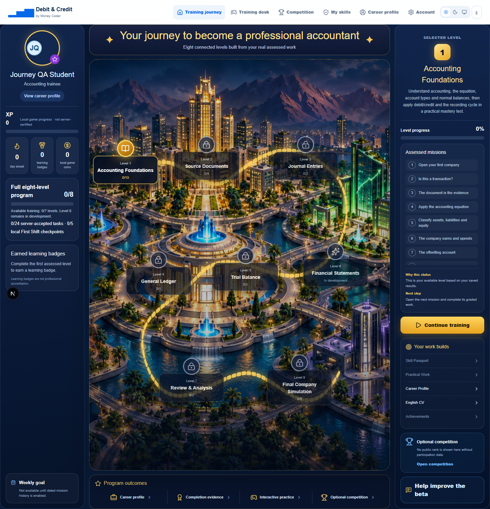
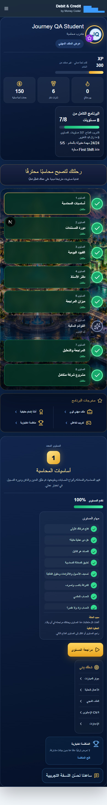
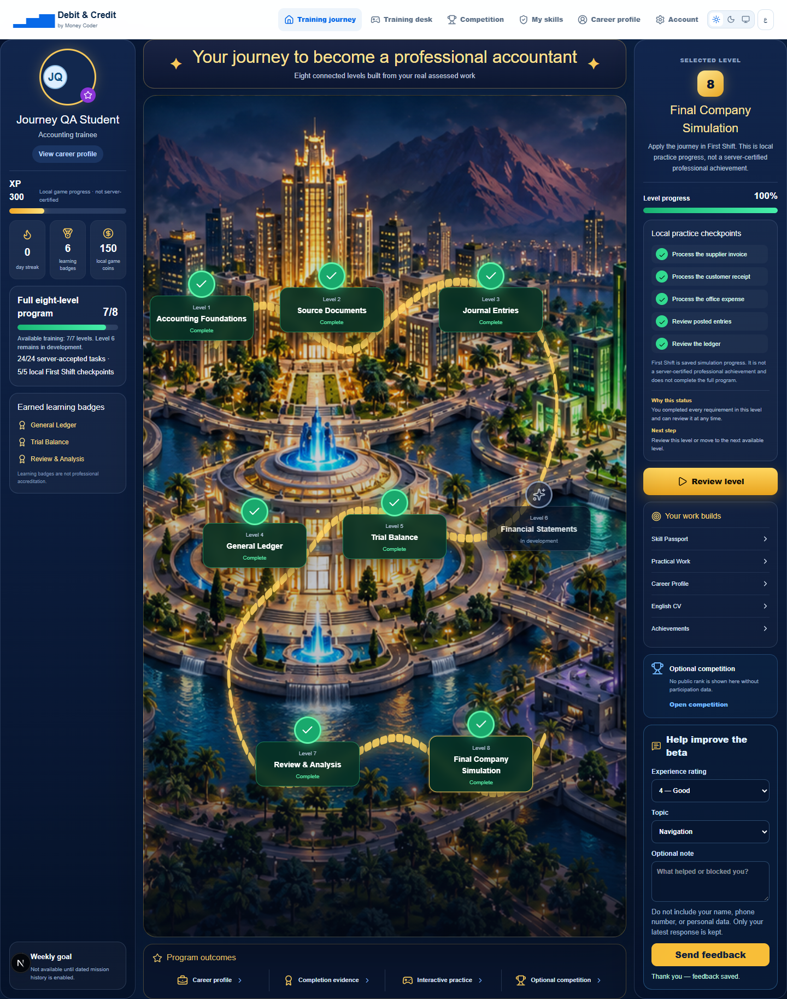

# Student Beta Release Readiness

Assessment date: 2026-11-14 (Africa/Cairo)

Repository: `AhmedMohamed500/Debit-Credit`

Tested release-candidate code SHA: `efab58b064712aa22464cc671f8f6c4aa1d5ed12`

PR #52 remote SHA at the start of the audit: `1a5214bfc7f6ada1ac390b98f3ed73c2b737a271`

The tested code is suitable for a controlled student beta after the two release blockers below are closed. It must not be merged or promoted to Production yet.

## Final recommendation

**NO-GO for inviting the 20 external testers today. Conditional GO for the code itself.**

Release blockers:

1. PR #51 and PR #52 are still Draft. The stacked dependency chain must be reviewed and merged in order; no merge was performed during this preparation.
2. The current PR #52 preview is protected by Vercel SSO and redirects unauthenticated visitors to Vercel. A minimally scoped Shareable Link or explicit tester invitations must be created by the project owner, checked in an incognito browser outside the Vercel team, and revoked after the beta. Vercel SSO must remain enabled.

## PR dependency chain

Live GitHub state was re-checked on 2026-11-14 before this report.

| PR | Base → head | Audited SHA | State | Merge/check state |
| --- | --- | --- | --- | --- |
| #49 — security-sensitive dependencies | `main` → `codex/phase2-security-upgrade` | `7458bed8e6801e7d69769db3210b5c1e373487db` | Open, ready for review | Mergeable, clean; Vercel successful |
| #50 — learning stages vs career outcomes | `codex/phase2-security-upgrade` → `codex/phase2-product-cleanup` | `578879bfe732115bb789a0ba8d8b2a048cecf7c7` | Open, ready for review | Mergeable, clean; Vercel successful |
| #51 — redundant student UX removal | `codex/phase2-product-cleanup` → `codex/phase3-remove-redundant-ux` | `f6e753f047f86e1b0881c7b11cfbb5c4182e0053` | Open, Draft | Mergeable, clean; Vercel successful |
| #52 — unified accounting journey | `codex/phase3-remove-redundant-ux` → `codex/unified-accounting-journey-v1` | baseline `1a5214b`; tested candidate `efab58b` | Open, Draft | Baseline mergeable and clean; new preview check required after push |

Git ancestry checks confirmed that each audited SHA is an ancestor of the next PR head. The combined `main..#52` code was tested as one stack. The safe merge order remains #49, #50, #51, then #52.

## Student journey result

The complete beginner path passed against the isolated PostgreSQL database `journey_v11_test`; the QA artifact records `productionWrites: false`.

| Journey step | Result |
| --- | --- |
| Arabic landing and primary CTA | Passed; CTA text is `ابدأ أول مهمة محاسبية` and routes to the protected journey/signup flow |
| Create account and sign in | Passed with a fresh isolated test account |
| Essential profile setup | Passed through the real profile form, without direct database seeding |
| Enter unified journey and start Level 1 | Passed |
| Incorrect answer and useful correction | Passed; no false completion was granted |
| Retry with correct answer | Passed through server grading |
| Complete first mission and save progress | Passed; server-confirmed completion and beta milestone recorded |
| Leave, switch account, and return | Passed; no cross-account progress leak |
| Resume exact next mission | Passed after refresh and after sign-in |
| Review learning outcomes | Passed from the journey outcome links |

## Seven available levels

The journey map and each implemented destination were checked in the browser:

- Level 1 — Accounting Foundations: `/bootcamp?mission=business-world`
- Level 2 — Source Documents: `/game/student?focus=document-control`
- Level 3 — Journal Entries: `/game/student?focus=journal-service`
- Level 4 — General Ledger: `/game/student?focus=ledger-cash`
- Level 5 — Trial Balance: `/game/student?focus=trial-balance`
- Level 7 — Review & Analysis: `/game/student?focus=classification-error`
- Level 8 — Final Company Simulation: `/game/first-shift`

Level 6 remains visibly marked **In development**. Complete implemented work is reported as **7/8** and **88%**, never as full eight-level graduation. Existing engine and assessment behavior is covered by the 733-test suite; Level 1 additionally received the full wrong-answer, corrected-answer, server-save, and resume browser path.

## Excel Accounting Lab

Excel Accounting Lab remains outside the core level map at `/bootcamp/excel-foundations`. QA captured the authenticated Excel record before visiting the unified journey and after returning from the separate Excel route; the records were byte-for-byte equivalent. No Excel record reset, migration, or replacement was introduced.

## Beta welcome, feedback, and measurement

The welcome area now states:

- the audience: Egyptian commerce students and recent graduates;
- the practice: foundations, documents, entries, review, and decisions;
- the offer: currently available content is free for invited beta participants;
- the limitation: Level 6 is in development and the platform does not claim full-program completion;
- one hero CTA: `ابدأ أول مهمة محاسبية`.

The feedback form stores only a 1–5 rating, one bounded topic, an optional note of at most 500 characters, a random feedback ID, and a timestamp. It explicitly tells testers not to enter a name, phone number, or personal data. Only the latest response is retained.

Beta measurement is first-party and stored in the existing authenticated progress store. It records only first timestamps for:

- signup proxy: first authenticated session after account creation;
- first mission started;
- first mission completed after server confirmation;
- returning learner after a mission start and at least a 30-minute gap.

There are no third-party analytics, page views, device fingerprints, contact fields, advertising identifiers, or additional personal profile fields. Session measurement is deduplicated once per authenticated browser session and is cleared through every implemented sign-out path.

## Bugs found and fixed

| Finding | Fix and evidence |
| --- | --- |
| Beta landing did not clearly identify the cohort, free scope, or incomplete Level 6 | Replaced the hero message and unified the primary CTA without changing the navy/gold visual system; Arabic desktop and 390px screenshots reviewed |
| No minimal in-product beta feedback | Added bounded, privacy-labeled feedback that retains only the latest response |
| Required beta milestones were absent | Added first-party, idempotent milestone records in existing storage; no database migration or analytics vendor |
| Repeated development reloads could exhaust the general write limit before a returning-learner event | Deduplicated session events and cleared the marker in all three sign-out paths; the isolated rerun passed returning-learner measurement with no 429 responses |
| The old browser script bypassed essential profile setup | QA now completes the actual profile form before entering the journey |
| Initial CSS placement broke the retained-style integrity guard | Kept the historical v4 snapshot byte-identical and appended beta overrides after it; all 47 organization guards and the full suite pass |

No broken primary buttons, duplicated journey navigation, inaccessible form labels, horizontal mobile overflow, or cross-account state leakage was found in the final run.

## Responsive screenshot review

The browser run checked Arabic and English at 1920, 1440, 768, 390, and 320 pixels, light and dark themes, reduced motion, keyboard focus, and RTL direction. All viewport-fit assertions passed.

### Arabic beta welcome — 390px

### New student journey — 1440px

### Completed available work — Arabic 390px

### Privacy-conscious beta feedback — 1440px

## Test results

| Check | Result |
| --- | --- |
| ESLint | Passed, zero warnings |
| TypeScript | Passed with `--noEmit --incremental false` |
| Vitest | **87 files, 733 tests passed** |
| Production build | Passed with Next.js 16.4.3 |
| Isolated browser QA | **62/62 checks passed**, zero uncaught browser errors |
| Responsive coverage | AR/EN at 1920, 1440, 768, 390, 320; light/dark; reduced motion; keyboard focus |
| Database safety | Isolated local database only; `productionWrites: false` |

The raw local QA summary is generated at `artifacts/unified-journey-v11/browser-qa.json` and is intentionally gitignored because it contains disposable test-environment artifacts.

## Preview access requirements

Current preview observed during the audit:

`https://debit-credit-git-codex-3e4f04-ahmed-mohameds-projects-c51bc2cc.vercel.app`

An unauthenticated request returned HTTP 302 to `vercel.com/sso-api`, confirming that Vercel protection is still active. No protection setting was changed.

Approved beta-access procedure:

1. Wait for the Vercel preview generated from the final PR #52 head to become Ready.
2. In Vercel, share only that preview using a Shareable Link or invite the named testers. Do not disable Vercel Authentication.
3. Keep the bypass token private; do not commit it, paste it into public issues, or use it in screenshots.
4. Test account creation, sign-in, and the first mission from an incognito browser that is not logged into the Vercel team.
5. Revoke the link or remove tester access when the controlled beta ends.

## Known limitations

- Level 6 is not implemented; there is no full eight-level graduation.
- The signup metric is intentionally a first-authenticated-session proxy rather than a separate personal-data event.
- Feedback has no contact field, so follow-up must happen through the separately managed tester cohort.
- The isolated run did not test real email delivery or an external Vercel Shareable Link.
- Development QA logs include non-blocking React hydration and above-the-fold image priority warnings on older marketing sections. They did not produce uncaught browser errors or responsive failures, but remain performance/cleanup follow-ups.
- No Production deployment, Production database write, subscription, database reset, engine rewrite, or merge was performed.

## Release gate

Change the recommendation to **GO** only when all of the following are true:

- PR #51 and #52 leave Draft after review;
- the final PR #52 Vercel check is successful;
- a private, revocable preview access method is created for the 20 testers;
- one non-team incognito tester completes signup, profile setup, and the first mission on that exact preview;
- no blocker is found in that access dry run.
